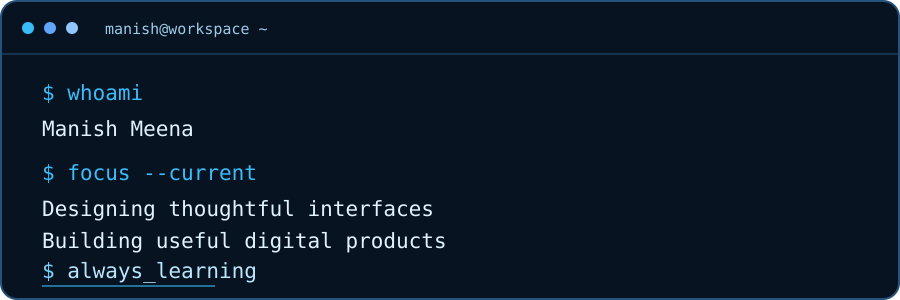

<!--
  MANISH MEENA | GitHub Profile
  Midnight blue identity: #071426 · #102A43 · #123B68 · #38BDF8
-->

  

   

  

   

  
  

---

## 

I'm **Manish Meena**, a graphic designer and developer from India. I enjoy bringing visual design and technology together to build digital products that are useful, considered, and easy to use.

My engineering interests include **local-first software, browser-based processing, privacy-conscious tools, and polished product interfaces**.

  

- 🎨 Background in graphic design and visual communication
- 🧩 Building practical web products from idea to deployment
- 🔒 Interested in privacy-first and on-device computing
- 🐙 GitHub: **[@manishmeena513](https://github.com/manishmeena513)**

## 

  <table>
    <tr>
      <td width="50%" valign="top">
        <h3><a href="https://github.com/manishmeena513/FileFixer">FileFixer ↗</a></h3>
        
🔒 <b>Private, browser-based file studio</b>

        
Image and document tools designed to process files on the user's device.

        
 

        <a href="https://filefixer.vercel.app/">Live demo</a>
      </td>
      <td width="50%" valign="top">
        <h3><a href="https://github.com/manishmeena513/Mock-Maker">Mock-Maker ↗</a></h3>
        
📚 <b>Competitive exam mock-test platform</b>

        
Structured practice with an 80% PYQ and 20% model-question mix.

        
 

        <a href="https://mockmaster-lyart.vercel.app">Live demo</a>
      </td>
    </tr>
    <tr>
      <td width="50%" valign="top">
        <h3><a href="https://github.com/manishmeena513/AXIS">AXIS ↗</a></h3>
        
🧭 <b>Offline-first navigation utility</b>

        
A 3D compass with coordinate tools, levels and solar/lunar information.

        
 

        <a href="https://axis-lac-pi.vercel.app">Live demo</a>
      </td>
      <td width="50%" valign="top">
        <h3><a href="https://github.com/manishmeena513/Atmos">Atmos ↗</a></h3>
        
🌤️ <b>Personalizable weather experience</b>

        
Atmospheric data, activity insights, visual effects and custom themes.

        
 

        <a href="https://atmos-gules-two.vercel.app/">Live demo</a>
      </td>
    </tr>
  </table>

## 

  

## 

- **Building:** practical web products with a focus on usability and thoughtful details
- **Exploring:** browser APIs, local-first architecture and on-device processing
- **Practising:** interface design, TypeScript, React and modern web development
- **Interested in:** privacy-conscious software, useful developer tools and visual experimentation

## 

  
  
   
  

## 

  

## 

  

## 

  <picture>
    <source media="(prefers-color-scheme: dark)" srcset="https://raw.githubusercontent.com/manishmeena513/manishmeena513/output/github-contribution-grid-snake-dark.svg" />
    <source media="(prefers-color-scheme: light)" srcset="https://raw.githubusercontent.com/manishmeena513/manishmeena513/output/github-contribution-grid-snake.svg" />
    
  </picture>

## 

- **Design with intention:** clarity, hierarchy, and details matter.
- **Build for people:** solve a real problem before adding features.
- **Respect privacy:** process data on-device whenever practical.
- **Keep it lean:** avoid needless complexity, dark patterns, and artificial gamification.

## 

  
  
    
  Designed with intent. Built with curiosity. 🇮🇳

  

